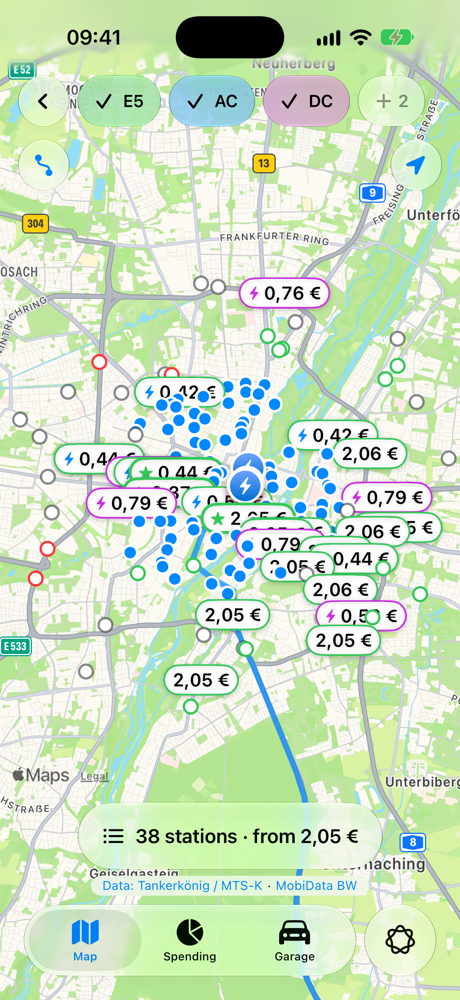
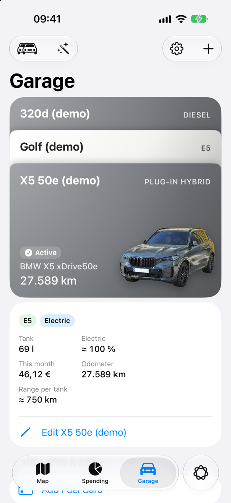
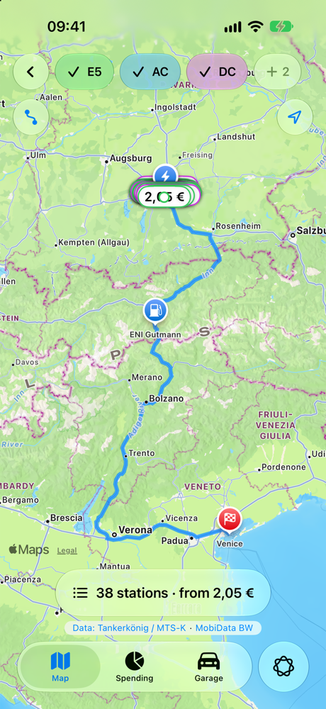
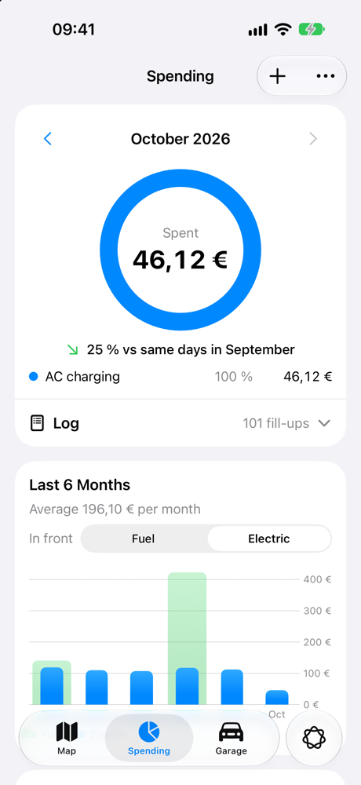
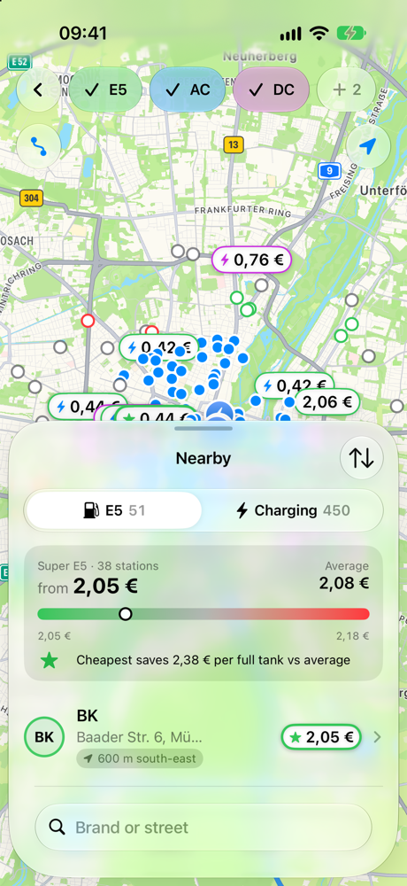
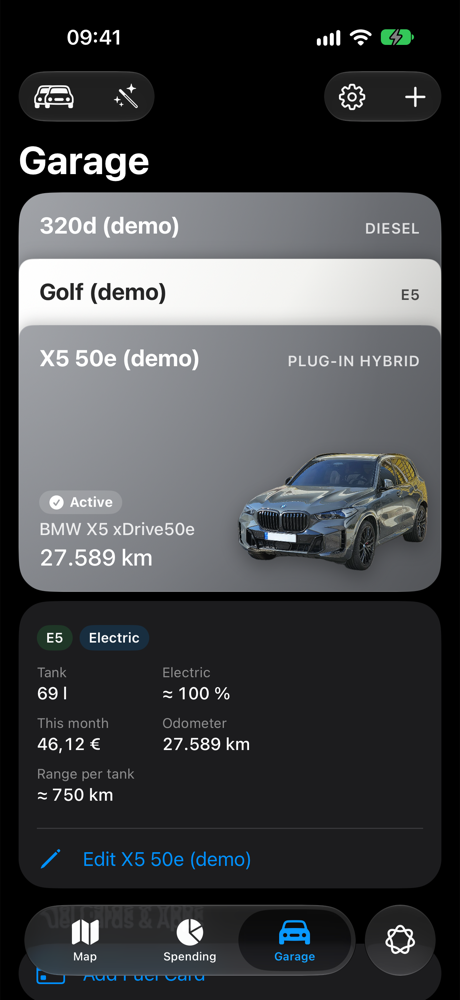
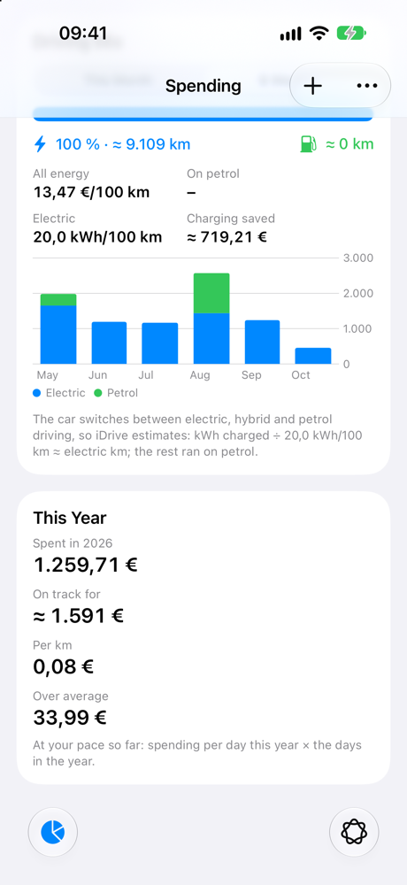
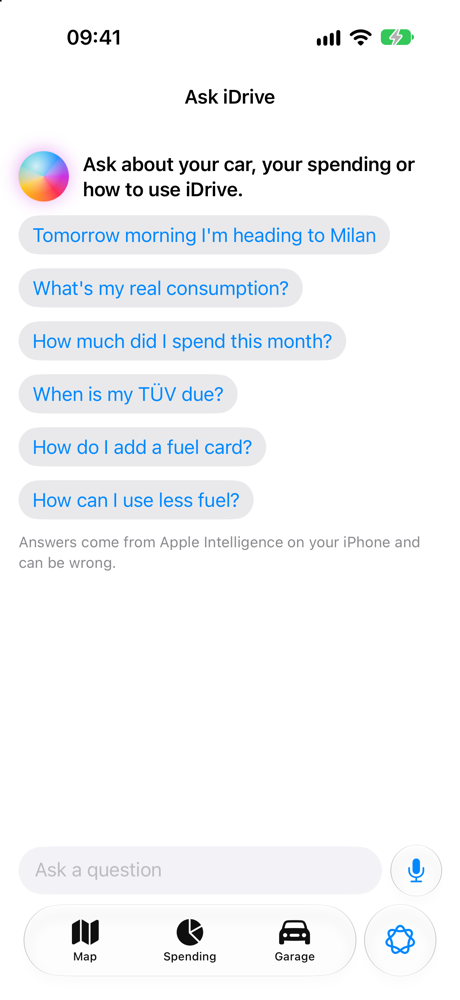

# iDrive

**Fuel prices, EV chargers, spending and consumption for the car you drive. An iOS app in SwiftUI.**

> [!NOTE]
> **The source code of this project is private.** This repository is its public showcase: the
> README, screenshots and every source file with its types and function signatures, but none of the
> code inside them. For a demo or access to the source code, email me at
> [christodontchev@gmail.com](mailto:christodontchev@gmail.com).

<p align="center">
  
  
  
  
</p>

iDrive follows your **active car**. The map shows the fuels it takes, the log records its fill-ups and
charges, spending adds up what it costs, and the trip planner works out where it should stop. Your data is
stored on your iPhone: there is no iDrive account and no tracking.

| | |
|---|---|
| Platform | iOS 27, iPhone, portrait, light and dark mode |
| Language | Swift 6 (strict concurrency, MainActor by default), SwiftUI, SwiftData, Liquid Glass |
| Project | [XcodeGen](https://github.com/yonaskolb/XcodeGen) (`project.yml`); the `.xcodeproj` is generated and not committed |
| Languages | English, German |
| Tests | 357 unit tests (Swift Testing) |

## Why iDrive

- **One app for petrol, diesel, electric and plug-in hybrid cars.** Prices, charging, the log and spending all
  follow the car you're driving today.
- **Real prices from official sources** in nine European countries, plus chargers with live status and €/kWh.
  Nothing is made up: a price that isn't reported isn't shown.
- **It learns your car.** Consumption comes from your own fill-ups, the weather on those days and how you
  drive, not from the brochure.
- **Private by design.** The assistant runs on the iPhone with Apple Intelligence, drives are recorded only on the
  iPhone, and API keys stay out of the code.

## Features

### Map: fuel prices and chargers



- Live fuel prices nearby for E5, E10 and Diesel, filtered to the active car's fuels. The cheapest station gets a
  star, and pins are coloured by how cheap each station is.
- **Premium Diesel** only where stations report its price (Spain, Italy, Portugal, Slovenia, Croatia, UK). It's
  never an estimate.
- Price sources in **Germany** (Tankerkönig / MTS-K), **Austria** (E-Control), **France** (prix-carburants),
  **Spain** (MINETUR), **Italy** (MIMIT), **Portugal** (DGEG), **Slovenia** (goriva.si), **Croatia** (Ministry of
  Economy) and the **UK** (retailers' CMA feeds). Every price is stored in euros.
- EV chargers from **MobiData BW** in Germany (live status and AFIR ad-hoc €/kWh), **NREL** in the US and Canada,
  **Open Charge Map** and **OpenStreetMap**. AC and DC are filtered separately.
- Fuel chips that remember your pick: choose another fuel and it stays in the row until you switch cars, or for
  5 minutes.
- Fuel cards and charging plans give the price you would actually pay at each station.
- A nearby list sorted by price or distance, showing the price range, the average and what the cheapest station saves
  on a full tank.

<br clear="right">

### Trip planner


- Plan a route with Apple Maps, then get the **cheapest** or **fewest-stops** plan for fuel or charging along it.
- It searches prices only where the car will need to stop, so it stays within API rate limits.
- Weather along the route and the car's learned consumption go into the estimate.
- The whole trip, every stop as a waypoint, opens in Apple Maps with one button.

<br clear="right">

### Garage



- Your cars are a **stack of passes, as in Wallet**. Each is in the car's paint colour with its cut-out photo.
  The active car is in front and the others peek out above it. Tap one to bring it to the front.
- Swipe the front car left for **Edit** and **Delete**; touch and hold any car to make it your main one.
- Add a car by make and model from the catalogue, or decode its **VIN**. Body style, colour, tank and battery
  size can be set too.
- A car photo has its background removed with Vision. Apple Intelligence suggests the make, model and colour.
- Petrol, diesel, battery-electric and **plug-in hybrid** cars are supported.
- **TÜV / inspection and service reminders** send notifications 30 and 7 days before the date.
- **Connected car** data through Smartcar: odometer, range and fuel or battery level.

<br clear="right">

### Log and spending



- Log a fill-up or a charge by hand, or **scan the receipt** with the camera (on-device OCR and a receipt parser).
- Any two of amount, price and total give the third, and odometer readings are validated against the history.
- Consumption is measured full tank to full tank, and outliers such as a forgotten fill-up are left out.
- Monthly spending compared with last month, six months of fuel and electricity, the year's total and where
  it's heading, the cost per km, and savings against the average price nearby.
- For plug-in hybrids: the share driven on electricity, the cost per 100 km, and what charging saved compared
  with petrol.

<br clear="right">

### Consumption engine and Drive Lab
- Predicts what the car uses from its own log: weather (Open-Meteo history), speed, roads and driving style.
- **Learn from My Drives** records drives on the iPhone, recognising the car by its CarPlay or Bluetooth link.
- Drive Lab (debug builds) shows what the engine learned and every recorded drive.

### Ask iDrive



- An on-device assistant (Apple Foundation Models) that answers questions about your cars, prices and trips,
  by text or voice.
- "Tomorrow morning I'm heading to Milan" plans the trip; "What's my real consumption?" and "When is my TÜV due?"
  answer from your own data.

<br clear="right">

### Widgets and Shortcuts
- Home Screen widgets: **Car & Map** (large), **Nearby Prices** (medium) and **Top 3 Stations** (small), plus the
  cheapest price on the Lock Screen. Widgets never call a price API; the app shares what it loaded through an App Group.
- App Shortcuts ("Find cheap diesel") and the `idrive://map?fuel=e10` deep link.

## Project layout

```
iDrive/
  App/            app entry, root tabs, sample and demo data
  Features/       Map, Trip, Garage, Log, Spending, Assistant, DriveLab
  Domain/         pure logic: fuel math, trip solver, consumption engine, receipt parser, VIN decoder
  Models/         SwiftData models (Vehicle, FillUp, FuelCard, …)
  Services/       price and charger APIs, location, Smartcar, weather, ride recorder
  DesignSystem/   cards, badges, filter bar, shared view modifiers
  Shared/         units and formatting, widget snapshot (shared with the widget)
  Intents/        App Intents and Shortcuts
iDriveWidget/     WidgetKit extension
iDriveTests/      unit tests (Swift Testing)
docs/             API research, credits, live behaviour reference
tools/            photo cut-out, receipt OCR bench, Smartcar proxy, docs generator, formatter
scripts/          API key check, install on iPhone
```

## Data and credits

Fuel prices: Tankerkönig / MTS-K (CC BY 4.0) and the national sources above. Chargers: MobiData BW, Open Charge Map
(CC BY 4.0), OpenStreetMap contributors (ODbL), NREL. Weather: Open-Meteo. Demo car photos come from Wikimedia
Commons; see [docs/CREDITS.md](docs/CREDITS.md) for authors and licences.

## License

© 2026 Christo Dontchev. All rights reserved. The source code is private and is not licensed for
use, copying or distribution; see [LICENSE](LICENSE).
